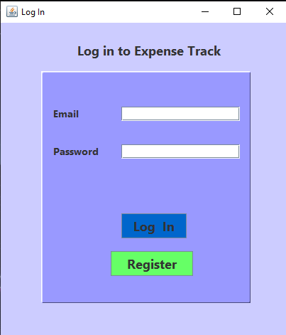
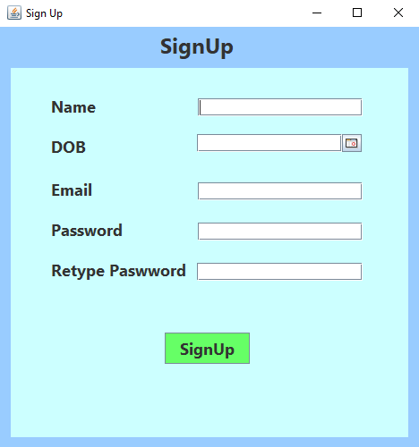
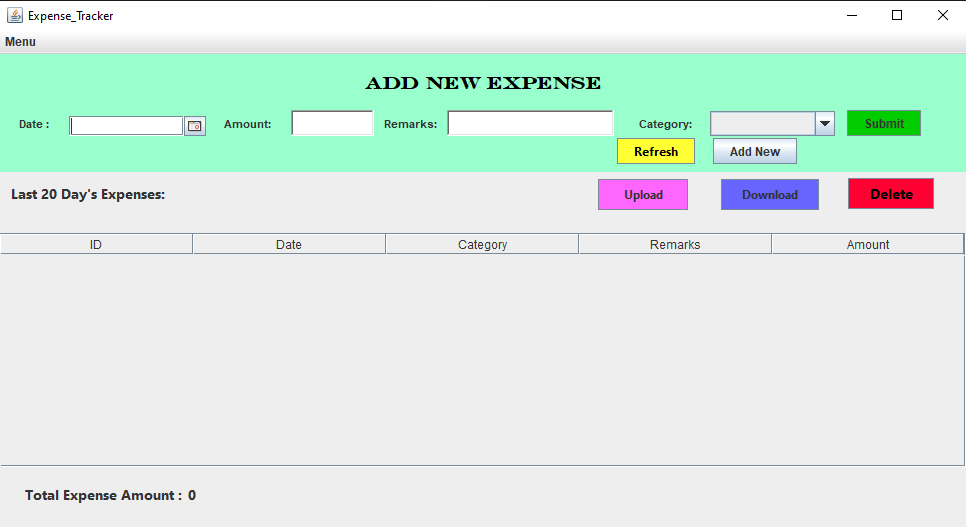
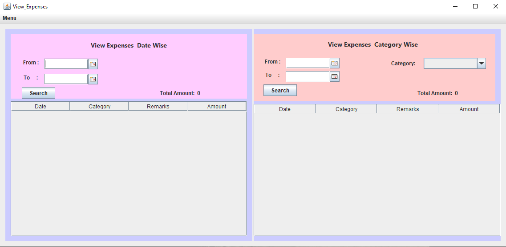
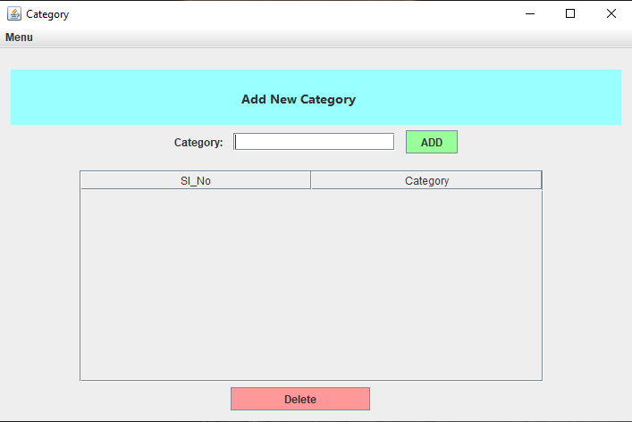
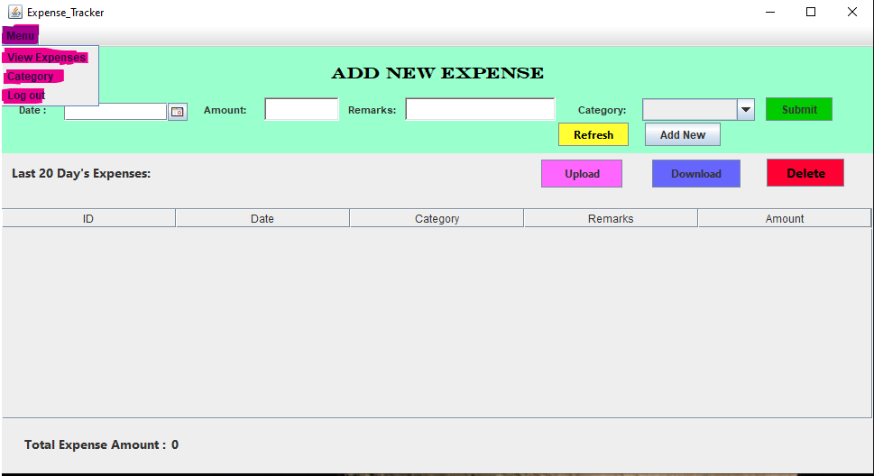

# 💰 Expense Tracker Desktop Application

A complete desktop application built with **Java Swing** and **MySQL** to track and manage personal expenses effectively. It includes user registration/login, dynamic category management, date & category-based expense filtering, and Excel export/import support using Apache POI.

---

## 🔗 Quick Links & Downloads

- 💻 **Direct App Executable (.exe):** [Download Expense Track (.exe)](https://drive.google.com/file/d/1PF1R0-xiSHlbPRUUGWl7WiqPXsABWXrI/view?usp=sharing)
- 🎥 **Video Tutorial / User Manual:** [Watch Setup & Usage Tutorial](https://drive.google.com/file/d/16d1psHLw4Y89PPU_YBO815RpeF2Am-Bn/view?usp=sharing)
- 📦 **Full Source Code Project (.zip):** Download `Expense_Tracker.zip` from this repository (contains the complete Maven project structure with `pom.xml`, `src/`, database script, etc., ready to open directly in IDEs).

---

## 📸 Screenshots & Preview

<p align="center">
  
  
</p>

<p align="center">
  
  
</p>

<p align="center">
  
  
</p>

---

## ⚙️ Prerequisites & Setup (Must Follow)

To run the desktop application (`.exe`) or the source code, your local computer must meet the following requirements:

### 1. Java Runtime Requirement
- **JDK 22 (64-bit)** must be installed on your machine (`jdk-22_windows-x64_bin.exe`).
- Ensure Java is added to your System Environment Path:
  ```bash
  java -version


### 2. MySQL Server Configuration

* **MySQL Server** must be installed and running on your local machine (default port: `3306`).
* The application connects to MySQL using the following default credentials:
* **Host:** `localhost:3306`
* **User:** `root`
* **Password:** `1234`


### 3. Database & Tables Setup

Open **MySQL Workbench** or your MySQL Command Line, and execute the following SQL script:

```sql
CREATE DATABASE IF NOT EXISTS expense_tracker_db;
USE expense_tracker_db;

CREATE TABLE IF NOT EXISTS user_details (
    id INT NOT NULL PRIMARY KEY AUTO_INCREMENT,
    name_ VARCHAR(30) NOT NULL,
    DOB DATE NOT NULL,
    email VARCHAR(30) NOT NULL,
    password_ VARCHAR(20) NOT NULL
);

CREATE TABLE IF NOT EXISTS expenses (
    ID INT NOT NULL PRIMARY KEY AUTO_INCREMENT,
    email VARCHAR(30) NOT NULL,
    password_ VARCHAR(20) NOT NULL,
    Date_Issue DATE NOT NULL,
    Category VARCHAR(20) NOT NULL,
    Remarks VARCHAR(30) NOT NULL,
    Amount INT NOT NULL
);

CREATE TABLE IF NOT EXISTS category (
    category_list VARCHAR(20) NOT NULL,
    email VARCHAR(30) NOT NULL,
    password_ VARCHAR(20) NOT NULL,
    CONSTRAINT unique_category_per_user PRIMARY KEY (category_list, email)
);

```

---

## 🚀 How to Run the Application

### Option A: Running via Desktop App (`.exe`)

1. Download the executable file from the [Google Drive Link](https://drive.google.com/file/d/1PF1R0-xiSHlbPRUUGWl7WiqPXsABWXrI/view?usp=sharing).
2. Ensure MySQL is running with the `expense_tracker_db` database created, and **JDK 22** is installed.
3. Double-click the `.exe` file to launch the application.

---

### Option B: Running via IDE (NetBeans / IntelliJ IDEA / Eclipse)

> ⚠️ **Note:** The `Expense_Tracker/src` folder contains raw UI forms and `.java` source files only and cannot be opened as a standalone project.

1. Download and extract **`Expense_Tracker.zip`** from this repository.
2. The zip archive includes the complete project directory (`pom.xml`, `src/`, `target/`, database scripts, and dependencies).
3. Open the extracted folder as an existing **Maven Project** in **Apache NetBeans**, **IntelliJ IDEA**, or **Eclipse**.
4. Allow Maven to download all dependencies.
5. Run `Main.java` or `Login.java`.

---

## 📂 Repository File Structure

```text
Expense_Tracker/
├── imgs/                               # Application UI screenshots
│   ├── add_category_frame_screenshot.png
│   ├── add_expense_frame_screenshot.png
│   ├── login_frame_screenshot.png
│   ├── menubar_screenshot.png
│   ├── signup_frame_screenshot.png
│   └── view_expenses_frame_screenshot.png
├── src/                                # Java source files & Swing GUI forms (.form)
│   ├── Category.form / Category.java
│   ├── Expense_Tracker.form / Expense_Tracker.java
│   ├── Login.form / Login.java
│   ├── Main.java
│   ├── View_Expenses.form / View_Expenses.java
│   ├── connection.java
│   └── signUp.form / signUp.java
├── Expense_Tracker.zip                 # Full Maven project zip (ready for IDEs)
└── README.md                           # Documentation & setup guide

```

---

## 🛠️ Built With

* **Language:** Java (JDK 22)
* **GUI Engine:** Java Swing & AWT
* **Database:** MySQL
* **Build Tool:** Apache Maven
* **Dependencies:**
* `mysql-connector-java (8.0.33)`
* `jcalendar (1.4)`
* `org.apache.poi (5.2.3)`


## 👤 Author
[@Mehedi-Hasan-Fahim](https://github.com/Mehedi-Hasan-Fahim)

